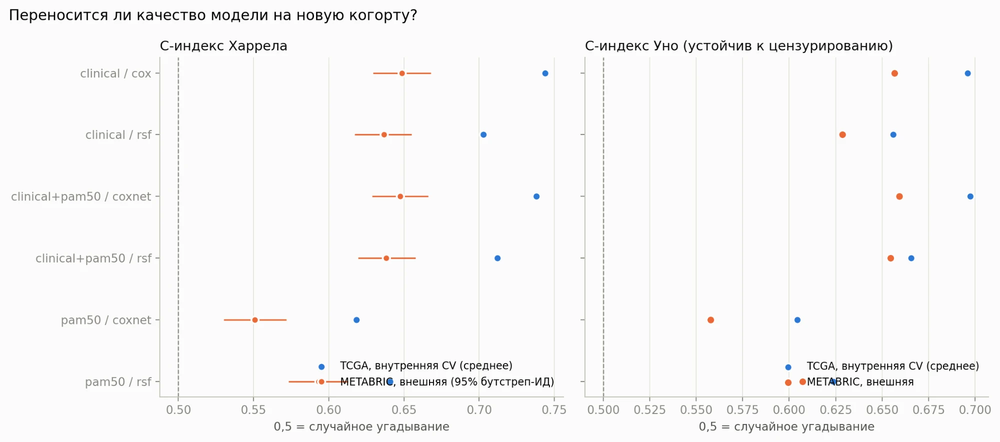

# Переносятся ли модели выживаемости при раке молочной железы на новую когорту? TCGA → METABRIC

## Вопрос

Какие клинические и молекулярные признаки предсказывают выживаемость при раке молочной железы
и сохраняет ли прогностическая модель, обученная на одной когорте (TCGA-BRCA, RNA-seq), своё
качество на независимой когорте (METABRIC, микрочипы) **без дообучения**?

## Главный результат

Обучение на TCGA-BRCA (1071 пациентка, 139 смертей), проверка на METABRIC (1980 пациенток,
760 смертей) без дообучения. Общая выживаемость, горизонт 120 месяцев. C-индекс Уно обрезан на
5 годах, веса по цензурированию берутся из оцениваемой когорты.

| Модель | Уно, внутренняя CV (TCGA) | Уно, внешняя (METABRIC) | Харрел, внешняя [95% ДИ] |
|---|---|---|---|
| Клиническая модель Кокса | 0,696 | 0,657 | 0,649 [0,630; 0,668] |
| Клиника + PAM50, elastic-net Кокс | 0,697 | 0,659 | 0,648 [0,629; 0,666] |
| Клиника + PAM50, случайный лес выживаемости | 0,666 | 0,655 | 0,638 [0,619; 0,658] |
| Только PAM50, elastic-net Кокс | 0,604 | 0,558 | 0,551 [0,530; 0,572] |

- Различающая способность переносится почти без потерь: C-индекс Уно клинической модели Кокса
  равен 0,696 внутри TCGA и 0,657 на METABRIC (0,675 у 74% пациенток METABRIC с известной
  стадией; при пропуске стадия подставляется медианой). Остаток разницы около 0,02 заметно меньше
  разброса по фолдам внутри TCGA (SD около 0,06).
- По Харрелу разница больше (0,744 → 0,649), но это в основном свойство когорт: медиана наблюдения
  в TCGA 32 месяца против 196 в METABRIC. Модель, обученная на METABRIC, даёт на TCGA Уно 0,696,
  как и собственная внутренняя кросс-валидация TCGA.
- Экспрессия PAM50 ничего не добавляет к клиническим признакам; сама по себе сохраняет слабый сигнал.
- На горизонте 5 лет клиническая модель Кокса занижает риск в METABRIC (в среднем предсказано
  около 17%, наблюдается около 22%); масштабированная оценка Брайера всего 0,04-0,06.



## Данные

Обе когорты публичные и скачиваются скриптом из
[cBioPortal DataHub](https://github.com/cBioPortal/datahub); регистрация не нужна, сами данные
в репозитории не хранятся.

| Когорта | Идентификатор | Роль | Экспрессия |
|---|---|---|---|
| TCGA-BRCA (PanCancer Atlas) | `brca_tcga_pan_can_atlas_2018` | разработка модели | RNA-seq (RSEM) |
| METABRIC | `brca_metabric` | внешняя валидация | микрочипы |

## Принятые решения

- **Конечная точка:** по умолчанию общая выживаемость (единственная точка, чётко определённая в
  обеих когортах); TCGA `DFS` ↔ METABRIC `RFS` включается через `ENDPOINT = "RFS"` в
  `src/config.py`. В TCGA-BRCA мало смертей, поэтому выбор точки важен.
- **Общий горизонт:** обе когорты административно цензурируются на 120 месяцах, потому что
  наблюдение в METABRIC намного длиннее, чем в TCGA.
- **Выбор метрики:** C-индекс Харрела зависит от длины наблюдения и цензурирования, а наблюдение
  в TCGA гораздо короче, чем в METABRIC, поэтому разница внутренней и внешней оценок по Харрелу
  может быть артефактом когорт. Рядом приводится C-индекс Уно (IPCW), по нему и стоит судить
  о переносимости.
- **Небольшая фиксированная панель генов (PAM50):** при ~100 событиях тысячи генов привели бы
  к переобучению.
- **Без утечки:** штраф и гиперпараметры подбираются внутри каждой обучающей выборки.
- **Различия платформ:** экспрессия логарифмируется (RNA-seq) и z-преобразуется по каждому гену
  внутри когорты. Так используется распределение экспрессии проверочной когорты (но не исходы);
  это указано как ограничение.

## Методы

| Этап | Раздел ноутбука | Методы |
|---|---|---|
| Данные, приведение к общему виду, таблица 1 | Часть 1 | обратный Каплан–Мейер для наблюдения, пропуски |
| Описательная выживаемость | Часть 2 | Каплан–Мейер, log-rank, Кокс, тест Шенфельда |
| Внутренняя валидация | Часть 3 | повторная стратифицированная 5-кратная CV; ridge-Кокс, elastic-net Кокс, случайный лес выживаемости |
| Внешняя валидация | Часть 4 | C-индексы Харрела и Уно, AUC(t), Брайер против базовой КМ-модели, калибровка, обратное направление |

## Структура репозитория

```
src/            настройки, загрузка данных, приведение к общему виду, модели, оценка, графики
notebooks/      *.py (формат percent, источник правды) и сгенерированные *.ipynb
scripts/        make_notebooks.py: сборка .ipynb из .py
tests/          проверка разбора и гармонизации на синтетических данных (python tests/test_harmonize.py)
data/           raw/ и processed/ в .gitignore (создаются в части 1)
reports/        рисунки и таблицы результатов
```

## Как запустить

```bash
python -m venv .venv && source .venv/bin/activate
pip install -r requirements.txt
python scripts/make_notebooks.py     # необязательно: собрать .ipynb из .py
jupyter lab                          # запустить notebooks/brca_survival.ipynb сверху вниз
```

Настройки (конечная точка, горизонт, использование стадии) лежат в `src/config.py`.

## Ограничения

- В TCGA-BRCA мало событий: оценки C-индекса шумные, доверительные интервалы широкие.
- Общая выживаемость включает смерти не от рака; когорты различаются по эпохе лечения и длине наблюдения.
- Стадия в когортах определена по-разному (переключается через `USE_STAGE`).
- Бутстреп-интервалы внешнего C-индекса отражают только разброс тестовой выборки, но не вариабельность обучения.
- Стадия пропущена у 26% пациенток METABRIC и при предсказании заменяется медианой TCGA; ограничение выборки пациентками с известной стадией повышает внешний C-индекс Уно примерно на 0,02 (раздел 4.7 ноутбука).
- Пропорциональность рисков нарушена для стадии, возраста и подтипа Basal в обеих когортах.
- Информация о лечении в модели не используется.
